<p align="center">
  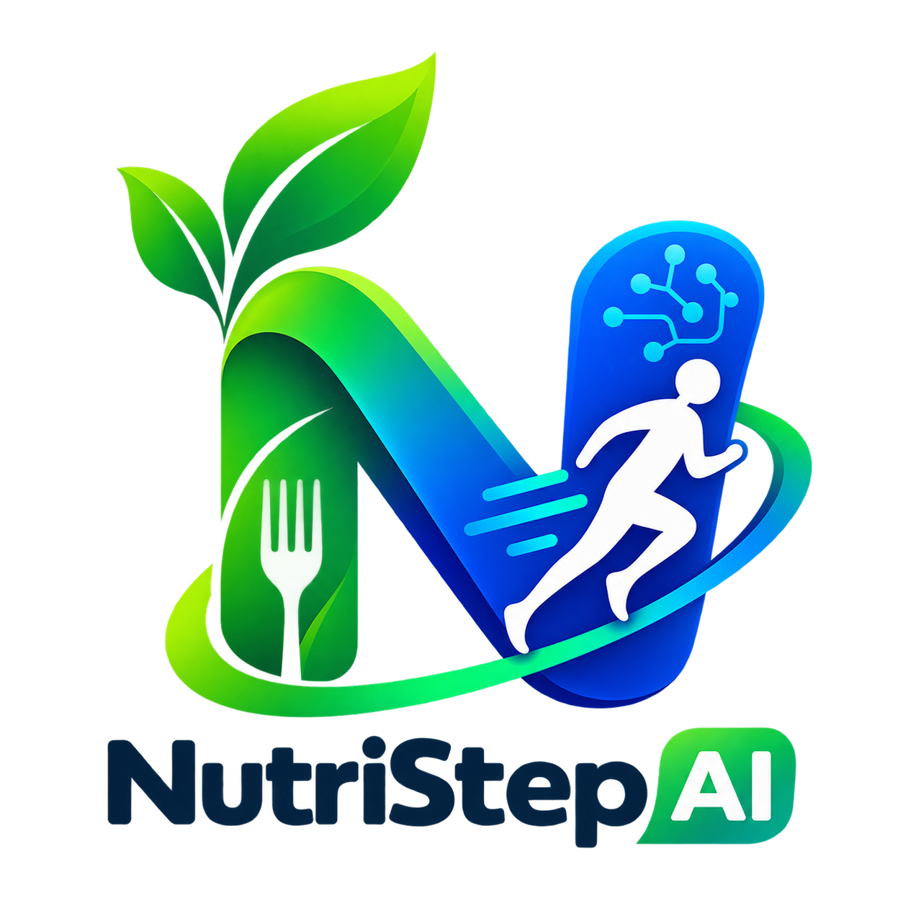
</p>

<h1 align="center">NutriStep AI</h1>

<p align="center">
  <b>Scan • Track • Live better</b><br>
  Snap a photo of your meal — AI counts the calories, protein, carbs and fat,<br>
  right next to your steps for the day.
</p>

<p align="center">
  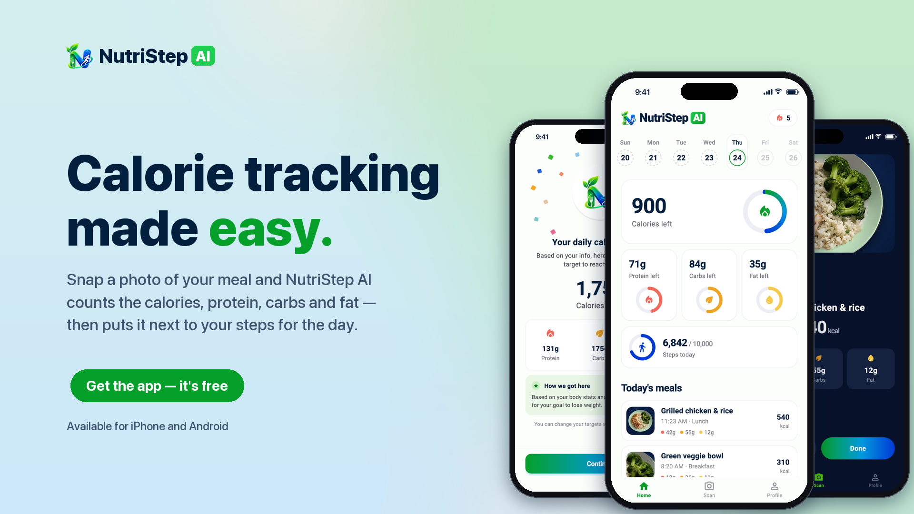
</p>

## Screenshots

<table>
  <tr>
    <td>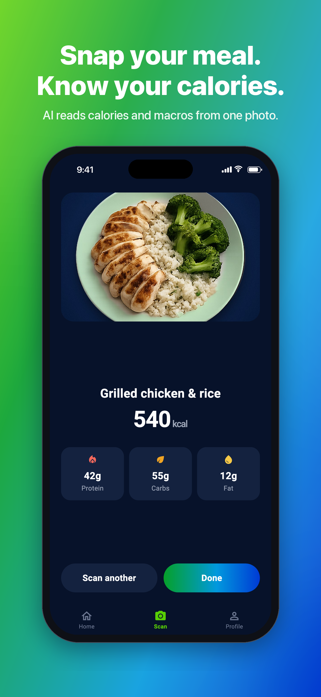</td>
    <td>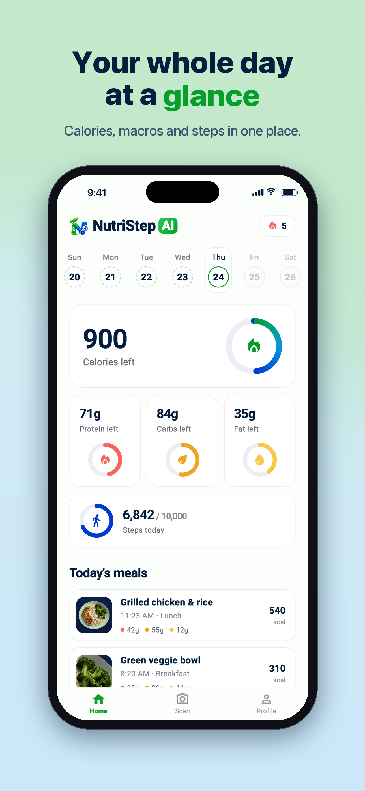</td>
    <td>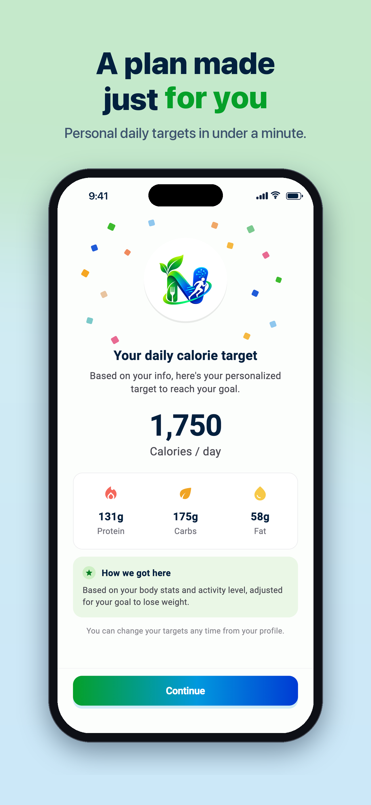</td>
    <td>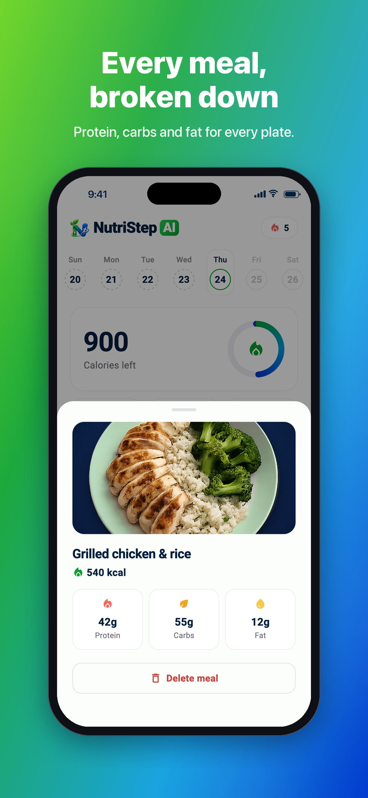</td>
    <td>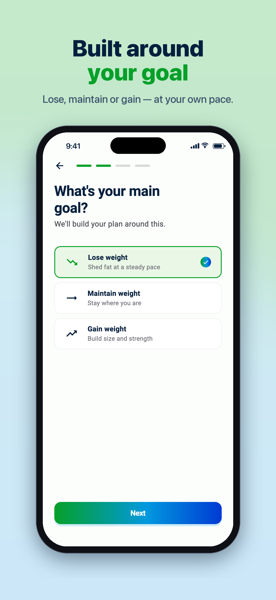</td>
  </tr>
  <tr>
    <td align="center">Snap your meal</td>
    <td align="center">Your day at a glance</td>
    <td align="center">A plan made for you</td>
    <td align="center">Every meal, broken down</td>
    <td align="center">Built around your goal</td>
  </tr>
</table>

## Features

- 📸 **AI food scanner** — photo → meal name, calories, protein, carbs and fat (Gemini)
- 🎯 **Personal daily targets** — a plan from your body stats, goal and pace
- 📊 **Home dashboard** — calorie and macro rings, a week-by-week date strip, today's meals
- 👟 **Step tracking** — daily steps next to your nutrition *(Health Connect / HealthKit, in progress)*
- 🔥 **Streaks** — consecutive days with a logged meal
- 🆓 **Free & Pro** — 2 scans a day free, 8 with Pro, enforced on the server
- 🔐 **Private by default** — every user sees only their own data (Postgres row-level security)

## Tech stack

| Layer | Choice |
| --- | --- |
| App | Flutter (Dart), go_router |
| Backend | Supabase — Postgres, Auth, Storage, Edge Functions |
| AI | Gemini (`gemini-3.5-flash-lite`), called only from the `analyze-meal` Edge Function |
| Camera | `camera`, `image_picker`, photos downsized to ~100 KB before upload |

## Getting started

**1. Supabase keys** — copy `env.example.json` to `env.json` and fill in your project URL and publishable key (`env.json` is git-ignored).

**2. Database and scan function**

```bash
supabase link --project-ref YOUR-PROJECT-REF
supabase db push
supabase secrets set GEMINI_API_KEY=your-gemini-key
supabase functions deploy analyze-meal
```

**3. Run**

```bash
flutter pub get
flutter run --dart-define-from-file=env.json
```

Without `env.json` the app runs in **demo mode**: everything in memory, no account needed — handy for working on the UI.

**Tests**

```bash
flutter test
```

## Project layout

```
lib/
  screens/     welcome, onboarding, sign-in, home, scan, profile
  widgets/     rings, buttons, sheets, brand
  state/       session (auth, profile, meals), Supabase setup
  plan/        calorie targets (Mifflin-St Jeor)
supabase/
  migrations/  schema, row-level security, scan quota
  functions/   analyze-meal (Gemini)
marketing/     App Store, Play Store, social and website images
```

## More images

| Play Store feature graphic | Instagram post | Instagram story |
| --- | --- | --- |
| 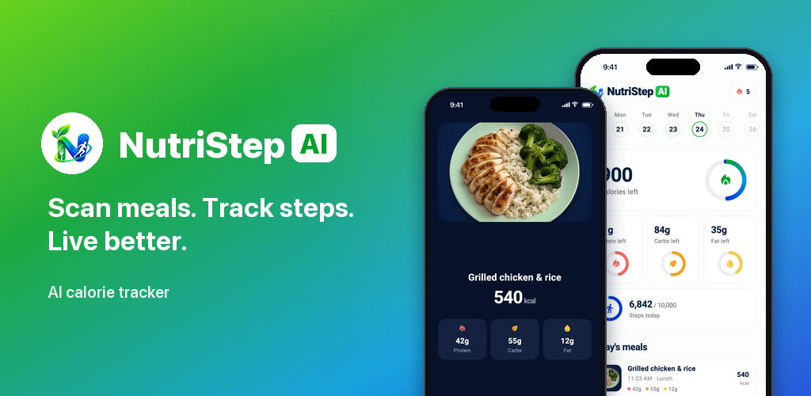 | 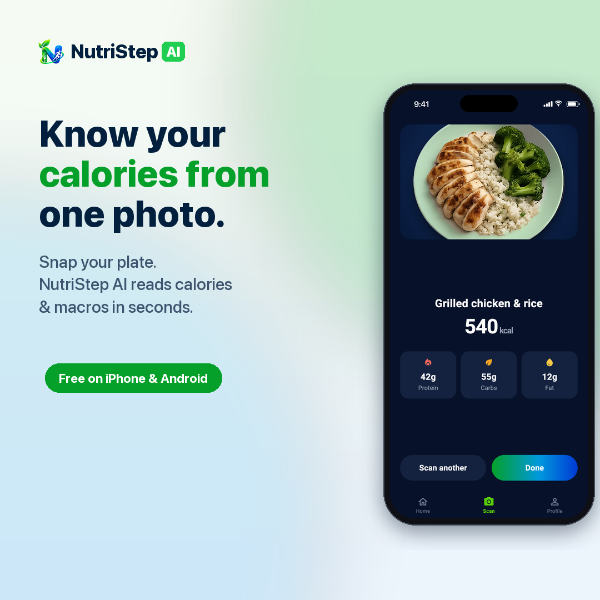 | 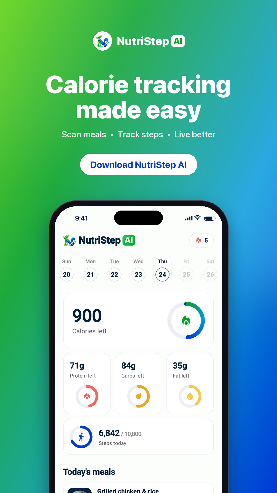 |

<p align="center">
  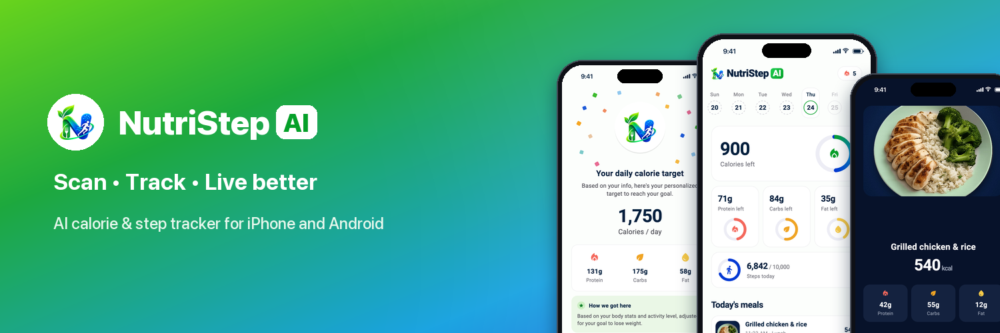
</p>
